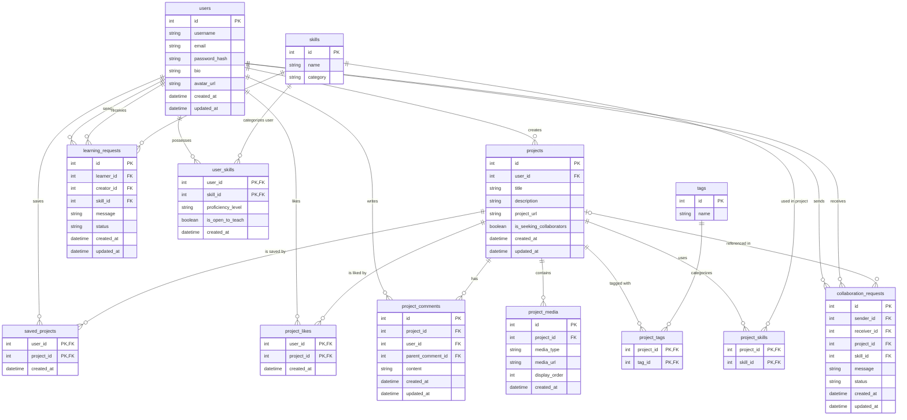

# IdeaLoop Database Setup

This directory contains the database migration and schema setup scripts for IdeaLoop.

## Module Ownership
- `modules/01_users_skills.sql` - Diya (Users, Skills, User_Skills)
- `modules/02_projects_media.sql` - Member 2 (Projects, Media, Tags)
- `modules/03_engagement.sql` - Member 3 (Likes, Comments, Saved Projects)
- `modules/04_requests.sql` - Member 4 & 5 (Learn Requests, Collaboration Requests)

## How to Run Locally

For the backend, prefer `npm run db:migrate` after configuring `.env`. The following raw SQL steps are an alternative; do not run both against the same database.

1. Ensure PostgreSQL is installed and running.
2. Create local database: `createdb idealoop_db`
3. Execute master schema: `psql -d idealoop_db -f db/schema.sql`
4. (Optional) Load sample data: `psql -d idealoop_db -f db/seed.sql`

# Database ERD

