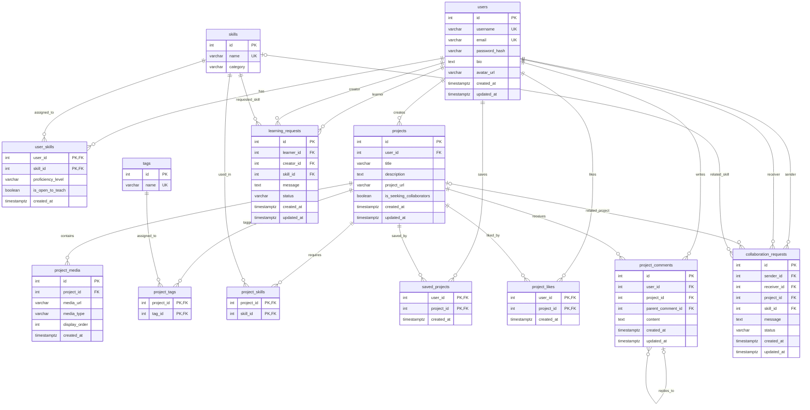

# IdeaLoop — Entity Relationship Diagram

This ERD documents the planned IdeaLoop database schema, based on migrations 001–005.

## Additional database constraints

- Usernames and email addresses are unique regardless of capitalization (migration 005).
- `user_skills.proficiency_level` accepts Beginner, Intermediate, Advanced, or Expert.
- `project_media.media_type` accepts image, video, audio, or document.
- Learning and collaboration request statuses accept pending, accepted, or declined.
- Learning requests must have different learner and creator IDs.
- Collaboration requests must have different sender and receiver IDs.
- Collaboration requests require at least one of `project_id` or `skill_id`.
- Nullable foreign keys include `project_comments.parent_comment_id`, `collaboration_requests.project_id`, and `collaboration_requests.skill_id`.
